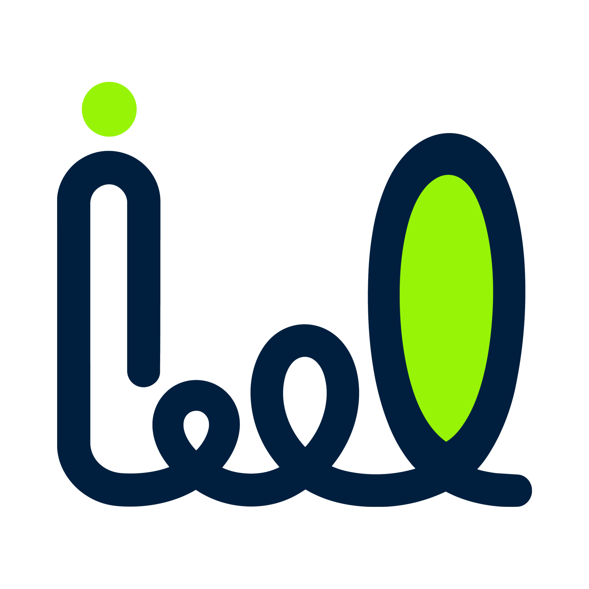

### Artificial Intelligence • Front-end • Linux • Machine Learning

---

## Sobre mim

Olá, sou **Gustavo Guimarães**.

Curso **Bacharelado em Inteligência Artificial** e faço parte do time de **Plataforma do InnovaLab**, atuando atualmente como **Front-end Developer** e expandindo meus estudos para **Back-end Development**.

Tenho interesse em **Machine Learning, Gesture Recognition, desenvolvimento Full-stack e Computação Quântica**.

Também sou entusiasta de **linguagens de programação, Linux e software livre**, com interesse especial em entender como aplicações, sistemas operacionais e hardware se conectam.

Atualmente, concentro meus estudos em **Python, desenvolvimento web e fundamentos de Inteligência Artificial**, buscando transformar teoria em projetos práticos.

---

## Tecnologias de Interesse

 

---

  
# Development Tools

<table>
<tr>

<td align="center" width="50%">

### Main Language

 

**Python**

</td>

<td align="center" width="50%">

### Linux

 

**Current:** Arch Linux  
**Next:** Void Linux

</td>

</tr>

<tr>

<td align="center" width="10%">

### Front-end

  

**HTML • CSS • JavaScript • React • Tailwind CSS • Vite**

</td>

<td align="center" width="10%">

### Development

  

**Git • GitHub • VS Code • npm**

</td>

</tr>
</table>

---

## Front-end Ecosystem

---

## Linux Experience

---

# Projetos

<table>

<tr>

<td width="30%" align="center">

### InnovaLab

</td>

<td width="70%">

## Site do InnovaLab

Projeto desenvolvido para representar digitalmente o **InnovaLab**, com foco em uma interface moderna, responsiva e interativa.

### Stack

 

`React` `Tailwind CSS` `Motion` `Firebase` `npm` `Vite`

</td>

</tr>

</table>

### Construir • Abstrair • Imaginar • Aprofundar

